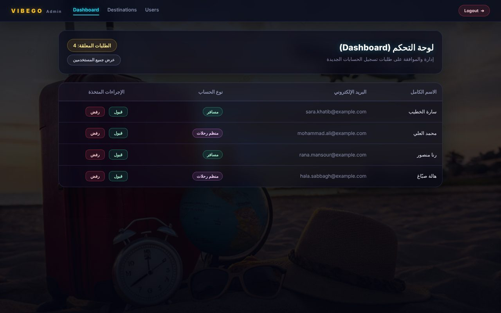
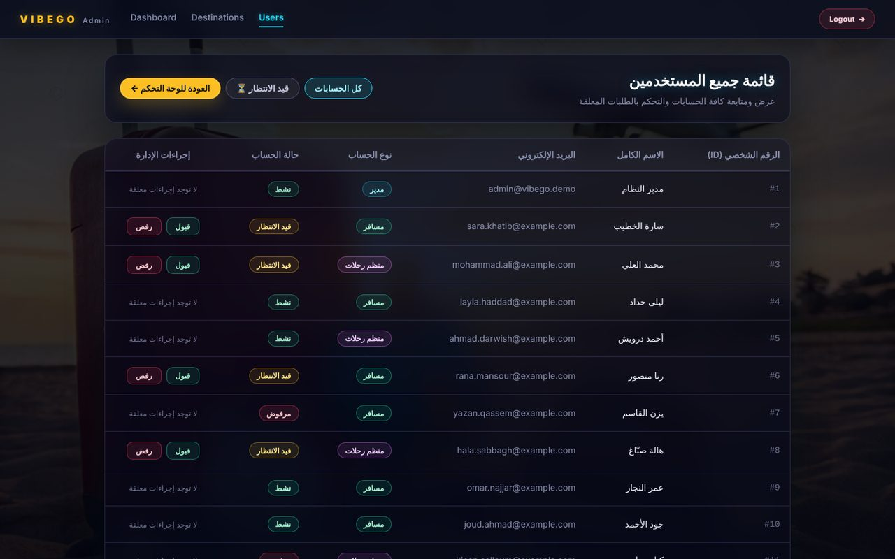
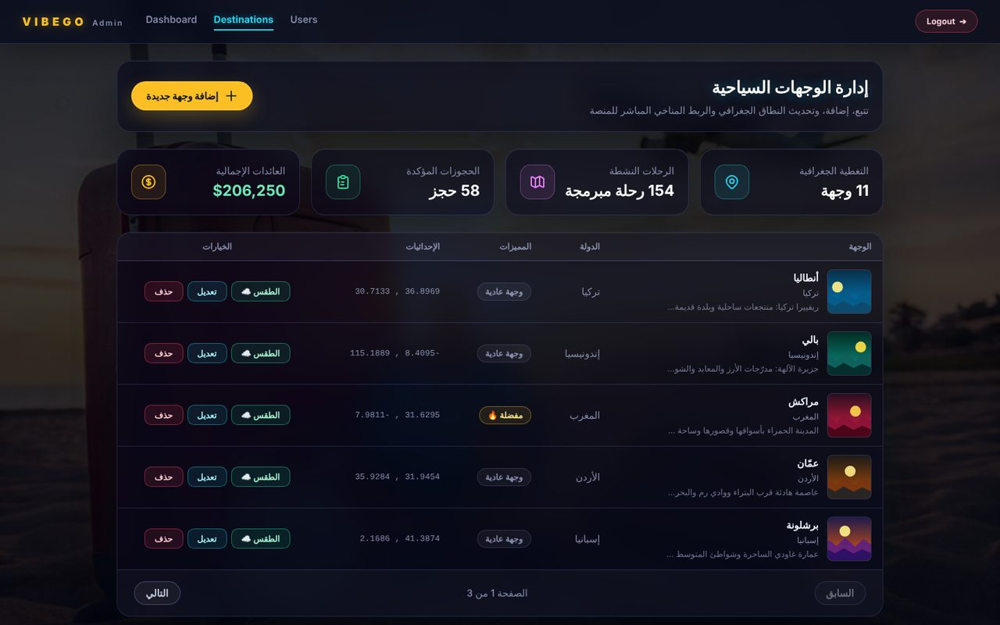
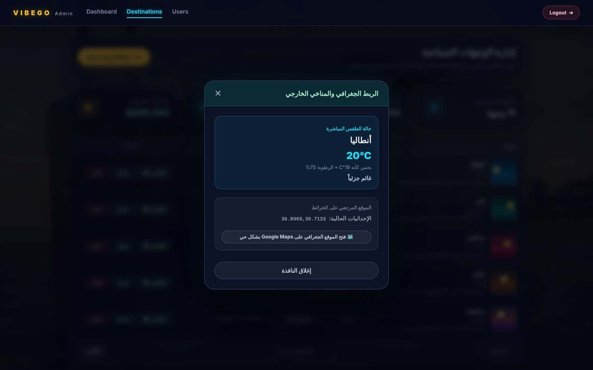
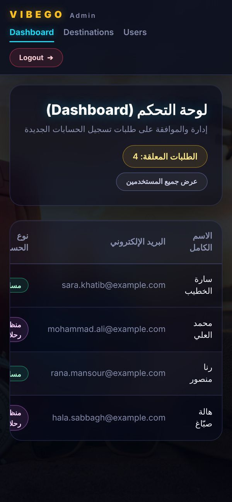

<div align="center">

# VIBEGO Admin Dashboard

**Admin panel for a smart travel and tourism platform. Arabic (RTL) UI, neon design, works on phones.**

[](https://mohamadmakarem62-eng.github.io/vibego-admin-dashboard/)


</div>

<div dir="rtl">

لوحة تحكم إدارة VIBEGO، منصة السفر والسياحة الذكية. مبنية بـ React وتدعم اللغة العربية (RTL) بالكامل.
المشروع يشتغل **بدون باك إند** عبر وضع تجريبي ببيانات وهمية، ويشتغل على الكمبيوتر والتابلت والموبايل.

</div>

## Live demo

**https://mohamadmakarem62-eng.github.io/vibego-admin-dashboard/**

Click **Log in** and use **any email and password**. The demo runs entirely in the browser with mock data,
so no server, database or account is needed. Changes (approve a user, add or delete a destination) last until you refresh the page.

Things to try:

- Log in and watch the plane take off before the dashboard opens.
- Use the password `wrong` to see the login error state.
- Use an email that starts with `user` (for example `user1@test.com`) to see the "admins only" rejection.
- Approve or reject a pending registration, then check the **Users** page.
- Add, edit and delete a destination, and open its weather and map details.
- Open the link on your phone.

## Features

- **Admin authentication:** token-based login, admin-role check, protected routes, and automatic redirect to login when the session expires (401).
- **Animated login:** neon glass card, a plane that cruises across the background, and a takeoff transition on success (respects `prefers-reduced-motion`).
- **Dashboard:** pending registration requests with approve and reject actions.
- **Users:** full user list with role and status badges, a pending filter, and approve or reject actions.
- **Destinations:** full CRUD, pagination, featured flag, coordinates, image preview, live stats cards, and a details modal with current weather and a Google Maps link.
- **Arabic RTL interface** with a consistent neon theme across all pages.
- **Responsive:** the layout adapts to phone screens, and wide tables scroll inside their own container instead of breaking the page.
- **Demo mode:** a built-in fake API (axios adapter) that mirrors the real backend's responses, so the whole app can be tried without a server.

## Screenshots

<table>
  <tr>
    <td></td>
    <td></td>
  </tr>
  <tr>
    <td></td>
    <td></td>
  </tr>
  <tr>
    <td></td>
    <td></td>
  </tr>
</table>

### On mobile

<p>
  
  
  
</p>

## Tech stack

| Area      | Tools                                                  |
| --------- | ------------------------------------------------------ |
| UI        | React 19, React Router 7                               |
| Styling   | Tailwind CSS 4 plus custom CSS for the neon theme      |
| Data      | Axios (with request and response interceptors)         |
| Build     | Vite 8                                                 |
| Quality   | ESLint                                                 |
| Hosting   | GitHub Pages, deployed by GitHub Actions               |

## Getting started

Requirements: **Node.js 20.19+ or 22.12+** and npm.

```bash
git clone https://github.com/mohamadmakarem62-eng/vibego-admin-dashboard.git
cd vibego-admin-dashboard
npm install
npm run dev:demo
```

Open http://localhost:5173 and log in with any email and password. No backend, database or environment variables are needed.

### Try it on your phone

Run the demo server so it is reachable on your local network:

```bash
npm run dev:demo -- --host
```

Then open the **Network** address printed in the terminal (for example `http://192.168.1.20:5173`) from a phone connected to the same Wi-Fi.

### Run with a real backend

Create a `.env.local` file (see `.env.example`):

```bash
VITE_API_URL=http://127.0.0.1:8000/api
```

Then start the app with `npm run dev`. The frontend expects these endpoints:

| Method | Endpoint                              | Purpose                                  |
| ------ | ------------------------------------- | ---------------------------------------- |
| POST   | `/v1/login`                           | Log in, returns `access_token` and user  |
| GET    | `/v1/admin/users/pending`             | Pending registration requests            |
| GET    | `/v1/admin/users/all`                 | All users                                |
| PUT    | `/v1/admin/users/:id/status`          | Approve or reject a user                 |
| GET    | `/v1/destinations?page=n`             | Paginated destinations                   |
| GET    | `/v1/destinations/:id/weather`        | Current weather for a destination        |
| GET    | `/v1/destinations/:id/map`            | Coordinates and map link                 |
| GET    | `/v1/admin/destinations/stats`        | Dashboard statistics                     |
| POST   | `/v1/admin/destinations`              | Create a destination                     |
| PUT    | `/v1/admin/destinations/:id`          | Update a destination                     |
| DELETE | `/v1/admin/destinations/:id`          | Delete a destination                     |

Response shapes follow Laravel conventions. See `src/services/mockApi.js` for exact examples.

## How demo mode works

When the app runs in `demo` mode (`npm run dev:demo`, `npm run build:demo`, or `VITE_DEMO=true`), `src/services/api.js`
swaps axios's network adapter for `src/services/mockApi.js`. That file answers every request from in-memory data,
including validation errors, pagination, authentication and a short artificial delay so loading states are visible.
It is loaded lazily, so it is not part of a normal production build.

## Scripts

| Command              | Description                                     |
| -------------------- | ----------------------------------------------- |
| `npm run dev`        | Dev server (needs the real backend)             |
| `npm run dev:demo`   | Dev server in demo mode (mock data)             |
| `npm run build`      | Production build into `dist/`                   |
| `npm run build:demo` | Production build in demo mode                   |
| `npm run preview`    | Preview the production build                    |
| `npm run lint`       | Run ESLint                                      |

## Deployment

The workflow in `.github/workflows/deploy.yml` builds the demo and publishes it to GitHub Pages on every push to `main`.
One-time setup: make the repository public, then open **Settings, Pages, Source** and choose **GitHub Actions**.
The site is served from `/<repo-name>/`, so the workflow passes the repository name to Vite as `BASE_PATH`.

## Project structure

```
src/
  components/
    destinations/   Page sections and modals (table, row, form, details, stats, pagination)
    FlightScene.*   Animated background and the takeoff animation
    icons.jsx       Inline SVG icons
  pages/            Landing, Login, Dashboard, Users, Destinations
  services/
    api.js          Axios instance, auth interceptor, demo-mode switch
    mockApi.js      In-browser fake backend for demo mode
  utils/            Destination image helpers
  admin.css         Admin layout and shared styles
  index.css         Tailwind import and theme colors
public/             Static assets (background, demo images)
.github/workflows/  GitHub Pages deployment
docs/screenshots/   Images used in this README
```

## Author

Built by [@mohamadmakarem62-eng](https://github.com/mohamadmakarem62-eng).
